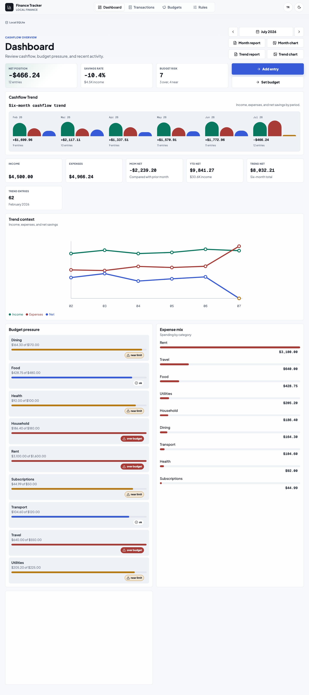
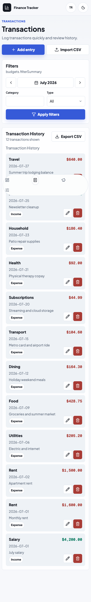
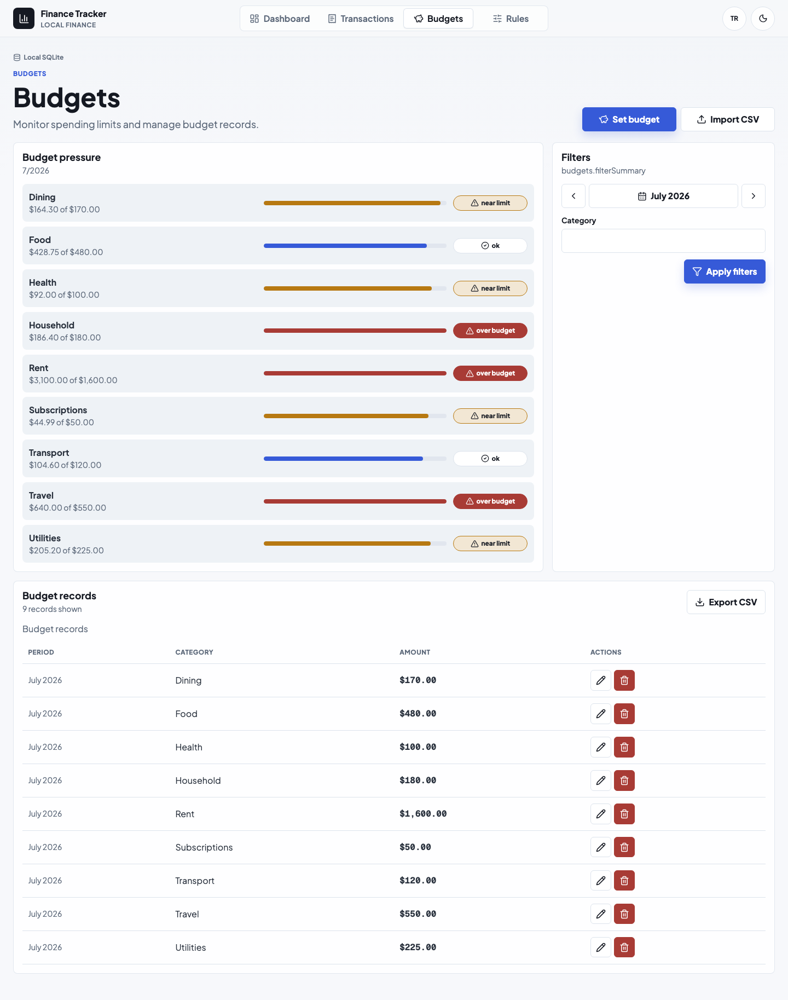

# Personal Finance Tracker

[](https://github.com/ErenTerakye/personal-finance-tracker/actions/workflows/ci.yml)


A Python CLI application for tracking income and expenses using SQLite, CSV processing, OOP, and data visualization.

## Highlights

- Add, edit, list, delete, import, and export financial transactions.
- Set monthly category budgets and compare them to actual expenses.
- Normalize category aliases so imports and manual entries roll into clean categories.
- Create monthly recurring transaction templates and apply them explicitly when needed.
- Import and export transactions and budgets with CSV files.
- Store records locally in SQLite.
- Generate monthly and multi-month income, expense, net savings, category, YTD, and month-over-month reports.
- Save optional PNG charts for monthly reports and trend reports.
- Run a polished local FastAPI JSON API and React Web UI with route-aware dashboard, transaction, budget, and rules workflows.
- Preview transaction CSV imports before writing, skip duplicates by default, import/export budget CSV files, and download report/chart artifacts from the dashboard.
- Configure one local ledger currency and use locale-aware English/Turkish browser formatting.
- Verify responsive and accessibility behavior with Playwright coverage.
- Use a clean `src/` package layout with Typer, pytest, and Ruff.

## Install

```bash
python3 -m venv .venv
source .venv/bin/activate
python -m pip install -e ".[dev,web]"
npm install
npm run build
```

## Quick Start

```bash
finance-tracker init --db-path demo.sqlite3
finance-tracker import-csv examples/sample_transactions.csv --db-path demo.sqlite3
finance-tracker import-budgets-csv examples/sample_budgets.csv --db-path demo.sqlite3
finance-tracker category-rule-set groceries Food --db-path demo.sqlite3
finance-tracker recurring-add expense 1600 --category Rent --description "Monthly rent" --day 1 --db-path demo.sqlite3
finance-tracker recurring-apply --month 7 --year 2026 --db-path demo.sqlite3
mkdir -p reports exports
finance-tracker list --month 7 --year 2026 --db-path demo.sqlite3
finance-tracker summary --month 7 --year 2026 --db-path demo.sqlite3
finance-tracker report --month 7 --year 2026 --chart reports/july-2026.png --db-path demo.sqlite3
finance-tracker trends --months 6 --end-month 7 --end-year 2026 --chart reports/trends.png --db-path demo.sqlite3
finance-tracker web --db-path demo.sqlite3
```

Open the Web UI at `http://127.0.0.1:8000`. The included sample CSVs are synthetic portfolio demo data, and `demo.sqlite3` is generated local demo state created from them. It is intentionally ignored by git and can be rebuilt at any time.

The default database path is `./data/finance_tracker.sqlite3`. That file is local runtime state for your own machine and may not match the documented demo. For the reviewer demo, start the local Web UI against the generated demo database:

```bash
finance-tracker web --db-path demo.sqlite3
```

## Demo Flow

Run a fresh local demo without touching the default database:

```bash
finance-tracker init --db-path demo.sqlite3
finance-tracker import-csv examples/sample_transactions.csv --db-path demo.sqlite3
finance-tracker import-budgets-csv examples/sample_budgets.csv --db-path demo.sqlite3
finance-tracker category-rule-set groceries Food --db-path demo.sqlite3
finance-tracker recurring-add expense 1600 --category Rent --description "Monthly rent" --day 1 --db-path demo.sqlite3
finance-tracker recurring-apply --month 7 --year 2026 --db-path demo.sqlite3
mkdir -p reports exports
finance-tracker budget-status --month 7 --year 2026 --db-path demo.sqlite3
finance-tracker import-csv examples/sample_transactions.csv --preview --db-path demo.sqlite3
finance-tracker report --month 7 --year 2026 --chart reports/july-2026.png --db-path demo.sqlite3
finance-tracker trends --months 6 --end-month 7 --end-year 2026 --chart reports/trends.png --db-path demo.sqlite3
finance-tracker web --db-path demo.sqlite3
finance-tracker export-csv exports/transactions.csv --db-path demo.sqlite3
finance-tracker export-budgets-csv exports/budgets.csv --db-path demo.sqlite3
```

## Reviewer Screenshots

These screenshots are generated from the July 2026 reviewer demo using `finance-tracker web --db-path demo.sqlite3` after importing the sample CSVs and applying the documented category rule and recurring template.







## Web UI

The local Web UI is an intentional portfolio-scale scope expansion: a Personal Finance Tracker for trend-first monthly review, transaction entry, and budget pressure checks. It remains local-first: the Python server reads and writes your SQLite database on your machine.

Architecture: FastAPI exposes JSON endpoints under `/api`, and a React + Vite + TypeScript SPA is served from the same local server after `npm run build`. Money values are sent as decimal strings so the browser never depends on floating-point rounding for stored amounts.

The browser application includes:

- A compact dashboard led by a six-month cashflow trend, KPI cards, budget pressure, category mix, and recent activity.
- Route-aware navigation for `/`, `/transactions`, `/budgets`, and `/rules`.
- A rules workspace for category aliases and recurring monthly transaction templates.
- Compact period controls for month-to-month review without always exposing month/year fields.
- Dialog-based transaction add/edit/delete and budget set/update/delete flows.
- Browser transaction CSV preview with duplicate detection and category alias display before import, plus CSV export for transactions and budgets.
- Dashboard downloads for monthly text reports, monthly PNG charts, six-month trend text reports, and six-month trend PNG charts.
- Read-only transaction tables that collapse into mobile-friendly record lists with compact row actions.
- A header theme action that follows your system color setting by default and can pin the opposite light/dark mode locally.
- An English/Turkish language action with local browser preference persistence and locale-aware money/date formatting using the active ledger currency.

During frontend development, run the Python app and Vite separately:

```bash
finance-tracker web --db-path demo.sqlite3
npm run dev
```

The browser interface uses modern platform features progressively, including semantic landmarks, accessible forms, native dialogs and popovers, SVG charts, container queries, color-scheme-aware dark mode with a persistent local override, mobile-safe viewport units, same-document view transitions, and reduced-motion-aware animation. The support policy is Baseline 2026-capable browsers; newer features must degrade without large polyfills.

GitHub Pages can host static files only, so it cannot run the live Python/SQLite app. A static showcase is available in [docs/showcase/index.html](docs/showcase/index.html) for portfolio hosting, while real CRUD requires `finance-tracker web`.

## Common Commands

```bash
finance-tracker add income 2500 --category Salary --description "July salary" --date 2026-07-01
finance-tracker add expense 428.75 --category Food --description "Groceries and summer market" --date 2026-07-09
finance-tracker edit 2 --amount 52.25 --category Household
finance-tracker category-rule-set groceries Food
finance-tracker recurring-add expense 1600 --category Rent --description "Monthly rent" --day 1
finance-tracker recurring-apply --month 7 --year 2026
finance-tracker budget-set Food 480 --month 7 --year 2026
finance-tracker budget-status --month 7 --year 2026
finance-tracker trends --months 6 --end-month 7 --end-year 2026
finance-tracker list --month 7 --year 2026
finance-tracker export-csv exports/transactions.csv
finance-tracker export-budgets-csv exports/budgets.csv
finance-tracker delete 1
```

Override the default database path with `--db-path` or the `FINANCE_TRACKER_DB` environment variable.

## CSV Formats

Transaction import and export use:

```csv
type,amount,category,description,date
income,4200.00,Salary,July salary,2026-07-01
expense,428.75,Food,Groceries and summer market,2026-07-09
```

Budget import and export use:

```csv
category,amount,month,year
Food,480.00,7,2026
Rent,1600.00,7,2026
```

## Project Structure

```text
src/finance_tracker/
  cli.py            # Typer commands
  models.py         # Domain objects and validation
  services.py       # Use-case coordination
  database.py       # SQLite setup
  repositories.py   # SQL queries
  csv_io.py         # CSV import/export
  reports.py        # Monthly report calculations
  charts.py         # PNG chart generation
  web/              # Local FastAPI JSON API and packaged SPA host
```

```text
frontend/
  src/              # React + TypeScript Personal Finance Tracker SPA
```

## Development

After activating the virtual environment, run:

```bash
.venv/bin/python -m pytest
.venv/bin/python -m ruff check .
npm test
npm run build
npm run test:e2e
.venv/bin/python -m build
```

For the first Playwright run on a new machine, install Chromium with `npx playwright install --with-deps chromium`.

GitHub Actions runs the Python checks on Python 3.14 and the frontend checks on Node 24.

See [ROADMAP.md](ROADMAP.md), [docs/PROJECT_PLAN.md](docs/PROJECT_PLAN.md), [docs/USAGE.md](docs/USAGE.md), and [AGENTS.md](AGENTS.md) for deeper project notes.

Use [docs/RELEASE_CHECKLIST.md](docs/RELEASE_CHECKLIST.md) when refreshing the demo, screenshots, packaged SPA assets, and release checks.
