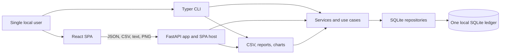
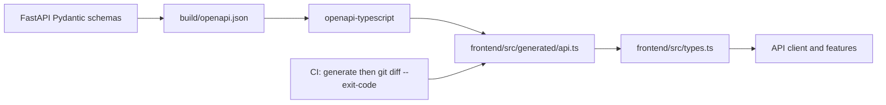
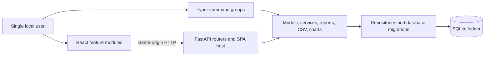
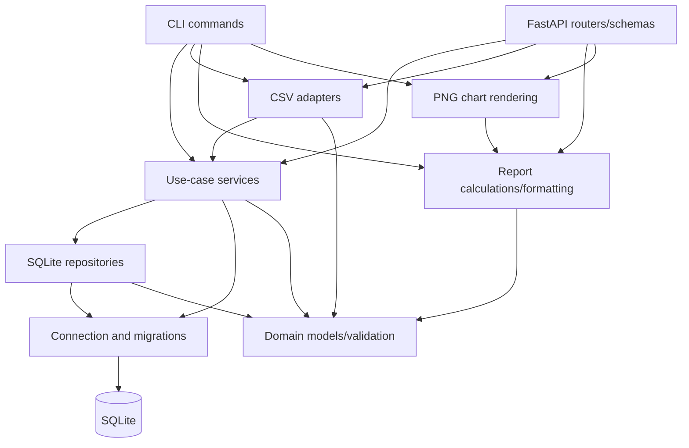
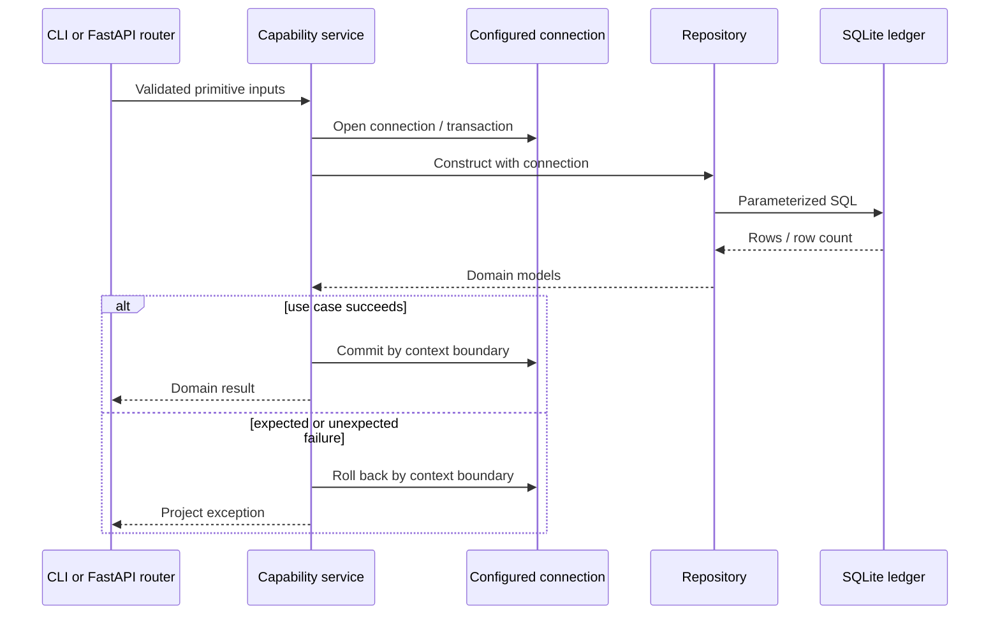
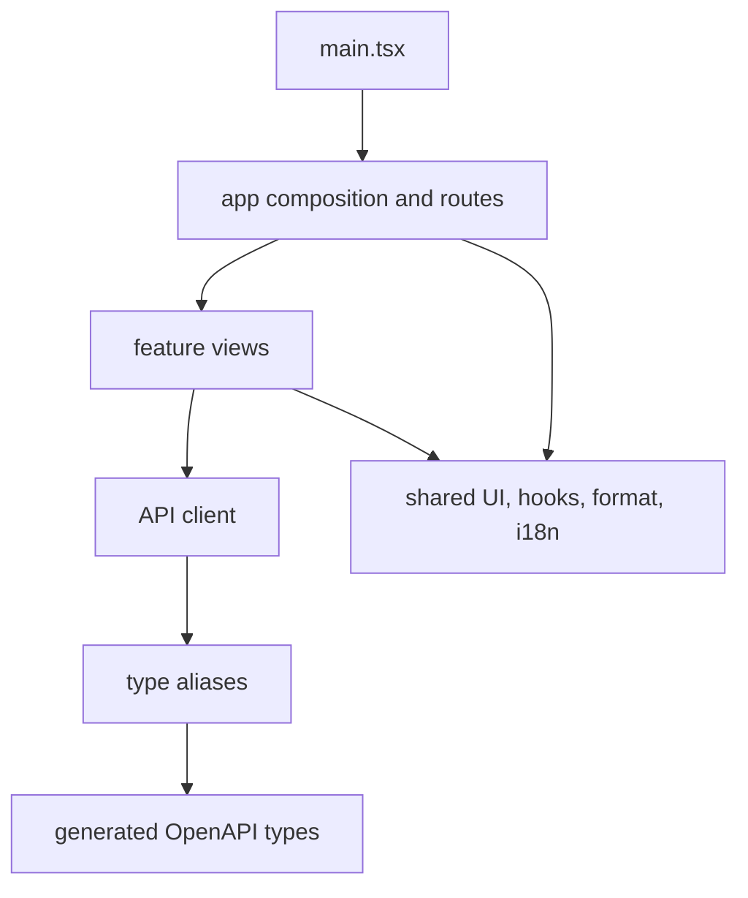
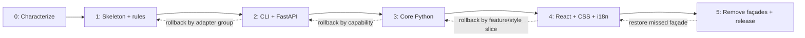

# Architecture Cleanup RFC

| Field          | Value                                                       |
| -------------- | ----------------------------------------------------------- |
| Status         | Implemented and verified                                    |
| Date           | 2026-07-10                                                  |
| Target release | Post-1.1 maintenance release; no version commitment         |
| Decision owner | Repository maintainer                                       |
| Scope          | Whole-repository structural cleanup                         |
| Compatibility  | No intentional breaking changes                             |
| Authority      | Historical decision and implementation record               |

## 1. Executive summary

Personal Finance Tracker remains a single-user, local-first layered modular monolith. This RFC
defines a conservative structural cleanup: split modules that have accumulated unrelated
responsibilities, make dependency rules executable, consolidate repeated browser state behavior,
and make CSS, localization, and tests easier to own. It does not replace the architecture, add
product features, or introduce ports-and-adapters, a dependency-injection container, a server-state
library, hosted infrastructure, or distributed components.

The migration is compatibility-first. Existing SQLite ledgers, CLI commands, JSON and artifact
endpoints, OpenAPI-derived TypeScript types, CSV formats, browser routes, security headers, and
Python packaging behavior are frozen unless a separately approved defect correction documents its
compatibility effect. Each phase is independently reviewable and reversible.

### 1.1 Goals

- Give every current hotspot one clear target owner and one coherent reason to change.
- Preserve the existing layer model while replacing oversized files with responsibility-focused
  packages and modules.
- Keep CLI and FastAPI entrypoints thin and reuse the same services, reports, CSV behavior, and
  persistence rules.
- Keep raw SQL in database/repository code and keep transaction ownership in services.
- Isolate browser transport, server-state orchestration, presentation, translation, and styling.
- Enforce the target dependency direction from the first migration phase.
- Improve consistency, accessibility, responsive behavior, and state feedback without redesigning
  workflows or information architecture.
- Maintain a reproducible portfolio demo, packaged SPA, and documented release process.

### 1.2 Non-goals

- New finance capabilities or changes to existing workflows.
- Authentication, authorization, hosted accounts, cloud sync, telemetry, or remote databases.
- Service workers, offline mutation queues, background workers, schedulers, or daemons.
- A framework replacement, microservices, ports-and-adapters rewrite, repository protocols, or a DI
  container.
- TanStack Query, Redux, CSS Modules, CSS-in-JS, a design-system package, or a CSS preprocessor.
- Mixed-currency accounting, automated exchange rates, or broader localization scope.
- Arbitrary line-count limits as quality gates. Cohesion and dependency ownership, not file length,
  determine module boundaries.

## 2. Verified baseline

This snapshot was measured from the repository and local toolchain on 2026-07-10. Declared version
ranges remain in the manifests; resolved versions describe the current reproducible baseline, not a
promise that future maintenance upgrades are prohibited.

### 2.1 Runtime and tooling

| Area              | Verified baseline                              | Source of truth                         |
| ----------------- | ---------------------------------------------- | --------------------------------------- |
| Python            | 3.14.6; project requires `>=3.14`              | `pyproject.toml`, local interpreter     |
| FastAPI           | 0.138.2                                        | installed web extra                     |
| Pydantic          | 2.13.4                                         | installed web extra                     |
| Typer             | 0.26.8                                         | installed project dependency            |
| Matplotlib        | 3.11.0                                         | installed project dependency            |
| SQLite library    | 3.51.0; schema version 1                       | local Python/CLI library, `database.py` |
| React / React DOM | 19.2.7                                         | `package-lock.json`                     |
| TypeScript        | 5.9.3                                          | `package-lock.json`                     |
| Vite              | 8.1.4                                          | `package-lock.json`                     |
| Vitest            | 4.1.10                                         | `package-lock.json`                     |
| Playwright        | 1.61.1                                         | `package-lock.json`                     |
| Node              | CI uses 24; package permits `>=24 <27`         | workflow, `package.json`                |
| Python checks     | pytest 9.1.1, Ruff 0.15.20, mypy 2.2.0 locally | installed dev extra                     |

The browser policy is Baseline 2026 with the repository minimums Chrome/Edge 132+, Safari/iOS
Safari 19+, Firefox 147+, and corresponding 2026 Android browsers. Modern features are progressive
enhancements: core navigation, forms, dialogs, and CRUD must remain usable when an enhancement is
unsupported or reduced motion is requested.

### 2.2 Current system context



Trust remains local: the web server binds to `127.0.0.1` by default and has no authentication.
Non-loopback binding exposes an unauthenticated financial ledger and remains discouraged.

### 2.3 Measured hotspots

Generated code is listed for completeness but is not a refactoring target. Measurements include the
current user worktree because those changes are part of the baseline and must not be discarded.

| Current file                          | Lines | Problem to solve                                                                                 | Target owner                                               |
| ------------------------------------- | ----: | ------------------------------------------------------------------------------------------------ | ---------------------------------------------------------- |
| `frontend/src/styles.css`             | 2,859 | Tokens, layout, components, features, states, and responsive rules share one cascade             | Layered style entrypoint and owned style modules           |
| `frontend/src/generated/api.ts`       | 1,886 | Generated OpenAPI output                                                                         | Generator only; do not hand-edit                           |
| `src/finance_tracker/web/app.py`      | 1,177 | App construction, middleware, errors, schemas, serialization, routes, artifacts, and SPA hosting | Web app factory plus web subpackages                       |
| `frontend/src/App.test.tsx`           |   910 | Most feature behavior is mocked and asserted in one suite                                        | Feature integration tests plus app composition smoke tests |
| `src/finance_tracker/cli.py`          |   779 | Root app, helpers, server startup, and every command                                             | CLI root, shared presentation, and command groups          |
| `frontend/src/i18n.tsx`               |   742 | Provider, persistence, types, English, Turkish, and notice localization                          | I18n runtime plus locale/namespace dictionaries            |
| `frontend/src/views/Rules.tsx`        |   670 | Settings, alias rules, recurring templates, presets, and playground state                        | Rules feature modules                                      |
| `frontend/src/components/Charts.tsx`  |   664 | Multiple charts, geometry, tooltips, tables, and KPI UI                                          | Chart primitives and chart-specific modules                |
| `frontend/src/views/Transactions.tsx` |   605 | Fetching, filters, form/dialog, import, mutations, and rendering                                 | Transactions resource hook plus feature components         |
| `frontend/src/views/Budgets.tsx`      |   522 | Fetching, filters, status, form/dialog, import, mutations, and rendering                         | Budgets resource hook plus feature components              |
| `src/finance_tracker/repositories.py` |   471 | Five repositories and shared query construction                                                  | Repository package by aggregate                            |
| `tests/test_web.py`                   |   446 | All HTTP domains and hosting behavior share one suite                                            | Router/contract/security/static test modules               |
| `src/finance_tracker/reports.py`      |   393 | Report values, monthly/trend calculations, and text formatting                                   | Report models, calculations, and formatters                |
| `src/finance_tracker/services.py`     |   386 | Five use-case services share one module                                                          | Service package by capability                              |
| `frontend/src/components/ui.tsx`      |   326 | Unrelated primitives and dialog behavior share one module                                        | Shared UI modules by primitive family                      |

## 3. Frozen compatibility contracts

“Frozen” means no intentional externally observable change during this cleanup. Internal import paths
may move only when a temporary re-export façade preserves imports used by tests, scripts, packaging,
or documented extension points. A discovered defect requires a separate change note, failing
characterization test, corrected test, and compatibility assessment.

### 3.1 CLI contract

The console entry point remains `finance-tracker = finance_tracker.cli:app`. The following 26 command
names, their options/arguments, exit-code intent, and machine-observable output meaning are frozen:

| Capability          | Commands                                                                 |
| ------------------- | ------------------------------------------------------------------------ |
| Setup/server        | `init`, `web`                                                            |
| Transactions        | `add`, `list`, `edit`, `delete`                                          |
| Budgets             | `budget-set`, `budget-list`, `budget-delete`, `budget-status`            |
| Category rules      | `category-rule-set`, `category-rule-list`, `category-rule-delete`        |
| Recurring templates | `recurring-add`, `recurring-list`, `recurring-delete`, `recurring-apply` |
| Reports             | `summary`, `report`, `trends`                                            |
| Transaction CSV     | `import-csv`, `export-csv`                                               |
| Budget CSV          | `import-budgets-csv`, `export-budgets-csv`                               |
| Settings            | `settings-get`, `settings-set`                                           |

Human-facing spacing may change only when required by a shared presentation helper and existing tests
prove the same information remains present. Command names, parameter defaults, validation meaning,
and success/error exit behavior may not change.

### 3.2 HTTP and artifact contract

The FastAPI title remains `Personal Finance Tracker`, version remains `1.1.0` during this migration,
and the following 26 operations remain available:

| Method | Path                                     | Contract role                        |
| ------ | ---------------------------------------- | ------------------------------------ |
| GET    | `/api/health`                            | Health response                      |
| GET    | `/api/dashboard`                         | Monthly dashboard aggregate          |
| GET    | `/api/transactions`                      | Filtered, paginated transaction list |
| POST   | `/api/transactions`                      | Create transaction                   |
| PATCH  | `/api/transactions/{transaction_id}`     | Partial transaction update           |
| DELETE | `/api/transactions/{transaction_id}`     | Delete transaction                   |
| POST   | `/api/transactions/import-csv`           | Import transaction CSV               |
| POST   | `/api/transactions/import-csv/preview`   | Preview transaction CSV              |
| GET    | `/api/transactions/export-csv`           | Export filtered transactions         |
| GET    | `/api/budgets`                           | Filtered, paginated budget list      |
| POST   | `/api/budgets`                           | Set or update a budget               |
| DELETE | `/api/budgets/{budget_id}`               | Delete budget                        |
| GET    | `/api/budgets/status`                    | Monthly budget status                |
| POST   | `/api/budgets/import-csv`                | Import budget CSV                    |
| GET    | `/api/budgets/export-csv`                | Export filtered budgets              |
| GET    | `/api/category-rules`                    | List alias rules                     |
| POST   | `/api/category-rules`                    | Set alias rule                       |
| DELETE | `/api/category-rules/{rule_id}`          | Delete alias rule                    |
| GET    | `/api/recurring-templates`               | List recurring templates             |
| POST   | `/api/recurring-templates`               | Create recurring template            |
| DELETE | `/api/recurring-templates/{template_id}` | Delete recurring template            |
| POST   | `/api/recurring-templates/apply`         | Apply templates for a month          |
| GET    | `/api/reports/monthly.txt`               | Download monthly text report         |
| GET    | `/api/reports/trends.txt`                | Download trend text report           |
| GET    | `/api/charts/monthly.png`                | Download monthly PNG chart           |
| GET    | `/api/charts/trends.png`                 | Download trend PNG chart             |
| GET    | `/api/settings`                          | Read ledger settings                 |
| PUT    | `/api/settings`                          | Update ledger settings               |

The operation count is 28 when every row is counted; the previously quoted “26 API operations” was
an inventory error caused by grouping artifact endpoints. The RFC corrects the count rather than
silently omitting two routes. All 28 operations above are frozen.

Error bodies remain `{ "error": { "code", "message", "fields?" } }`. List responses retain their
entity arrays and `page: { limit, offset, total }`. Money remains a decimal string. Mutation notices
retain both English `notice` and stable `notice_code`. CSV uploads retain the 5 MiB limit and content
type validation.

The following Pydantic/OpenAPI schema names remain stable:

`ApiErrorDetail`, `ErrorResponse`, `NoticeResponse`, `ImportSummaryResponse`,
`TransactionRequest`, `TransactionPatchRequest`, `BudgetRequest`, `CategoryRuleRequest`,
`RecurringTemplateRequest`, `SettingsRequest`, `SettingsResponse`, `TransactionResponse`,
`TransactionPreviewRecordResponse`, `BudgetResponse`, `CategoryRuleResponse`,
`RecurringTemplateResponse`, `BudgetStatusResponse`, `MonthlyReportResponse`, `TrendMonthResponse`,
`TrendReportResponse`, `DashboardResponse`, `PageResponse`, `TransactionListResponse`,
`TransactionMutationResponse`, `BudgetListResponse`, `BudgetMutationResponse`,
`CategoryRuleListResponse`, `CategoryRuleMutationResponse`, `RecurringTemplateListResponse`,
`RecurringTemplateMutationResponse`, `RecurringApplyResponse`,
`TransactionImportPreviewRowResponse`, `TransactionImportPreviewResponse`, and
`BudgetStatusListResponse`.

Security response behavior is frozen:

- `X-Content-Type-Options: nosniff`
- `Referrer-Policy: no-referrer`
- `Permissions-Policy: camera=(), microphone=(), geolocation=()`
- CSP allowing only same-origin scripts, styles, fonts, and connections; same-origin/data images;
  with objects disabled, same-origin base URIs, and framing disabled
- `Cache-Control: no-store` for `/api/` responses

### 3.3 Generated TypeScript contract

`scripts/export_openapi.py` remains the only source of `build/openapi.json`, and
`openapi-typescript` remains the only source of `frontend/src/generated/api.ts`. Generated output is
never hand-edited. The aliases exported by `frontend/src/types.ts` remain stable, including
transaction, budget, report, settings, rule, recurring, import-preview, pagination, mutation, and
error types. `TransactionType` remains `"income" | "expense"`.



### 3.4 SQLite contract

Schema version remains `PRAGMA user_version = 1`. Money remains decimal text and dates remain ISO
text. Existing unversioned v1 ledgers must still be stamped/upgraded without data loss.

| Table                 | Frozen purpose and constraints                                                                                          |
| --------------------- | ----------------------------------------------------------------------------------------------------------------------- |
| `transactions`        | Autoincrement ID; income/expense check; positive validated decimal text; category, description, ISO date, creation time |
| `budgets`             | Monthly category budget with validated month/year and decimal text                                                      |
| `category_rules`      | Case-insensitive unique alias to canonical category                                                                     |
| `recurring_templates` | Income/expense template, day 1–31, active integer boolean                                                               |
| `settings`            | String key/value settings; existing/default currency behavior                                                           |

Frozen indexes are `idx_transactions_date`, `idx_transactions_category`,
`idx_transactions_type`, `idx_transactions_filter`, `idx_transactions_duplicate`,
`idx_budgets_period`, `idx_budgets_period_category`, `idx_category_rules_alias`, and
`idx_recurring_templates_active`.

Connections continue to enable foreign keys, a 5,000 ms busy timeout, WAL mode, and
`synchronous=NORMAL`. Services own use-case transaction boundaries. Repositories execute SQL and
must not commit or roll back independently. Migrations remain ordered, transactional, and forward
only; no schema migration is expected for this cleanup.

### 3.5 CSV, routes, package, and assets

Transaction CSV remains:

```csv
type,amount,category,description,date
```

Budget CSV remains:

```csv
category,amount,month,year
```

Invalid-row reporting, missing-column failure, canonical category handling, preview behavior, and
duplicate safeguards remain unchanged.

Browser routes remain `/`, `/transactions`, `/budgets`, and `/rules`, plus the existing not-found
view. History behavior, selected-period behavior, language/theme persistence, and document title/lang
updates remain observable contracts.

The Python package continues to include `web/static/**/*`, the console entry point, and the optional
`web` dependency group. Vite continues to emit the production SPA to
`src/finance_tracker/web/static/spa`, with hashed assets under `assets/`. The fallback HTML,
`theme-init.js`, favicon, generated OpenAPI TypeScript, packaged SPA assets, static showcase,
screenshots, sample CSVs, and demo generation flow remain release-managed artifacts.

Current gzip budgets remain 100 KiB for the single JavaScript bundle and 15 KiB for the single CSS
bundle. Phase 4 may intentionally produce multiple route chunks; before enabling route splitting,
`scripts/check_bundle.mjs` must be changed to enforce a 100 KiB initial JavaScript budget, a 15 KiB
initial CSS budget, and explicit per-lazy-chunk limits rather than requiring exactly one file.

## 4. Target architecture

### 4.1 Architectural principles

1. Preserve the existing layers; improve ownership within them.
2. Depend inward toward models and use-case behavior. Entry points may orchestrate but not own rules.
3. Use concrete classes and explicit construction. Add no protocols or DI container without a real
   second implementation and a separate ADR.
4. Keep framework types at entry-point boundaries. Domain models do not import FastAPI, Pydantic,
   Typer, React, or browser APIs.
5. Keep SQL visible and local to repositories/database code.
6. Make compatibility façades temporary, documented, and removable.
7. Prefer native browser semantics and CSS capabilities over JavaScript recreation or dependencies.
8. Optimize measured bottlenecks; do not apply containment, caching, memoization, or workers by
   default.

### 4.1.1 Target containers

The deployment topology does not change. The target makes internal ownership explicit while keeping
one Python process, one packaged browser application, and one SQLite ledger.



### 4.2 Target Python tree

The final target tree is normative. `__init__.py` files re-export only the supported names currently
imported from the former single modules; new internal code imports the defining module directly.

```text
src/finance_tracker/
  __init__.py
  __main__.py
  config.py
  exceptions.py
  database.py
  models/
    __init__.py
    common.py
    transactions.py
    budgets.py
    category_rules.py
    recurring.py
  repositories/
    __init__.py
    common.py
    transactions.py
    budgets.py
    category_rules.py
    recurring.py
    settings.py
  services/
    __init__.py
    transactions.py
    budgets.py
    category_rules.py
    recurring.py
    settings.py
  csv_io/
    __init__.py
    common.py
    transactions.py
    budgets.py
  reports/
    __init__.py
    models.py
    monthly.py
    trends.py
    formatting.py
  charts/
    __init__.py
    common.py
    monthly.py
    trends.py
  cli/
    __init__.py
    app.py
    common.py
    transactions.py
    budgets.py
    category_rules.py
    recurring.py
    reports.py
    csv_commands.py
    settings.py
    web.py
  web/
    __init__.py
    app.py
    dependencies.py
    errors.py
    middleware.py
    responses.py
    static.py
    schemas/
      __init__.py
      common.py
      transactions.py
      budgets.py
      rules.py
      reports.py
      settings.py
    routers/
      __init__.py
      health.py
      dashboard.py
      transactions.py
      budgets.py
      category_rules.py
      recurring.py
      reports.py
      settings.py
    static/
      fallback.html
      spa/
```

`finance_tracker.cli:app` remains valid by exporting `app` from `cli/__init__.py`. Existing imports
such as `from finance_tracker.services import TransactionService` remain valid through package
re-exports until Phase 5 confirms all documented and repository consumers have migrated. No façade
may contain business logic.

### 4.3 Python ownership and dependency rules



Normative rules:

- `models` imports only the standard library and project exceptions.
- `database` owns connection configuration, schema SQL, and ordered migrations.
- `repositories` owns raw SQL and row mapping; it accepts configured connections and never commits.
- `services` owns application validation/orchestration and the complete commit/rollback unit.
- `csv_io` owns CSV parsing/formatting and may call public services; it does not execute SQL.
- `reports` performs deterministic calculations/formatting and does not open database connections.
- `charts` imports report values and Matplotlib; Matplotlib appears nowhere else.
- `cli` and `web` are inbound adapters and do not import repositories or execute SQL.
- Only `cli/web.py` may lazily import `web.app` to start Uvicorn. The web package never imports CLI.
- Pydantic models and HTTP response construction remain in `web`; Typer types and terminal formatting
  remain in `cli`.
- Cross-capability calls use the public service, model, or repository package API. They do not deep
  import another capability's private helper.

Enforcement starts in Phase 1 with `tests/architecture/test_python_imports.py`. It uses `ast` and
path classification from the standard library, reports the importer/imported pair, and encodes the
rules above. A checked-in allowlist may cover only the temporary CLI-to-web startup import and named
compatibility façades; every allowlist entry includes its removal phase.

### 4.4 Web request and transaction flow



FastAPI dependencies resolve the database path and construct concrete services. They do not become
a general dependency injection framework. Routers validate transport input, call one or more public
use cases, and construct frozen response schemas through domain-specific response helpers.

### 4.5 Target frontend tree

```text
frontend/src/
  main.tsx
  app/
    App.tsx
    AppShell.tsx
    routes.ts
  api/
    client.ts
    artifacts.ts
    errors.ts
  generated/
    api.ts
  features/
    dashboard/
      DashboardView.tsx
      useDashboard.ts
      components/
    transactions/
      TransactionsView.tsx
      useTransactions.ts
      transactionForm.ts
      components/
    budgets/
      BudgetsView.tsx
      useBudgets.ts
      budgetForm.ts
      components/
    rules/
      RulesView.tsx
      useCategoryRules.ts
      useRecurringTemplates.ts
      components/
  shared/
    components/
      actions.tsx
      dialogs.tsx
      feedback.tsx
      fields.tsx
      lists.tsx
      tables.tsx
    charts/
      CashflowTrend.tsx
      TrendLines.tsx
      CategoryBars.tsx
      ChartTooltip.tsx
      ChartDataTable.tsx
      geometry.ts
    hooks/
      useDebounce.ts
      useResource.ts
      useMutation.ts
    format/
      dates.ts
      money.ts
      periods.ts
    i18n/
      I18nProvider.tsx
      notices.ts
      types.ts
      locales/
        en/
        tr/
    theme/
      ThemeToggle.tsx
      preference.ts
    styles/
      index.css
      tokens.css
      reset.css
      base.css
      layout.css
      components.css
      features.css
      utilities.css
      overrides.css
  test/
    setup.ts
```

Feature subdirectories may split further when a component has an independent testable
responsibility; they may not introduce a second architecture hierarchy. Existing exported component
names remain available where tests or app composition use them until Phase 5.

### 4.6 Frontend dependency rules



- `generated` imports nothing from application code and is modified only by generation.
- `api` imports generated/type aliases and browser primitives, never React or feature modules.
- `shared` does not import features or app composition.
- A feature may import `api` and `shared` but not another feature. Cross-feature composition happens
  in `app`; genuinely reusable presentation moves to `shared`.
- App composition may import all features and shared modules but never call `fetch` directly.
- `fetch` is used only in `api/client.ts`; artifact URL construction is isolated in
  `api/artifacts.ts`.
- Feature views do not own generic request lifecycle logic. They consume focused resource/mutation
  hooks and own only feature state and composition.
- Deep imports across package boundaries are forbidden unless they address a defining public module.

Existing ESLint configuration enforces these rules with `no-restricted-imports` patterns and
directory-specific overrides. No dependency-cruiser package is added.

### 4.7 Custom resource and mutation hooks

`useResource` is a small shared orchestration primitive, not a cache:

- Input: a stable loader accepting `AbortSignal`, a dependency key, and an enabled flag.
- State: discriminated `idle | loading | success | error`, retaining data only when the caller
  explicitly requests stale-data display.
- On dependency/refetch change, abort the prior request and start a new request.
- On cleanup, abort the request. Ignore any completion whose request generation is no longer current,
  even if the adapter did not honor abort.
- Normalize thrown values through `ApiError`; never display unknown object stringification.
- Expose `refetch()` with a monotonic generation counter. Do not use timestamps as React keys.

`useMutation` standardizes `idle | pending | success | error`, prevents accidental duplicate submit
while pending, and exposes `mutate` plus `reset`. Successful mutations call an explicit feature-owned
refresh callback. No global cache, automatic retries, optimistic updates, or hidden background
revalidation is introduced. Destructive operations remain confirmation-gated.

### 4.8 CSS architecture

The global cascade order is normative:

```css
@layer tokens, reset, base, layout, components, features, utilities, overrides;
```

`index.css` declares that order. Source modules are imported by the TypeScript entrypoint in the same
order or combined by Vite at build time. The emitted production CSS must contain no runtime
`@import`; network waterfalls are not accepted. `scripts/check_css_architecture.mjs` verifies the
declared order, forbids undeclared layers and runtime imports in built CSS, and uses only Node core
modules.

Layer responsibilities:

| Layer        | Ownership                                                                                                  |
| ------------ | ---------------------------------------------------------------------------------------------------------- |
| `tokens`     | Literal/semantic color, type, spacing, radius, elevation, motion, safe-area, and z-order custom properties |
| `reset`      | Element-specific normalization; no indiscriminate universal reset                                          |
| `base`       | Document, typography, links, selection, language, color-scheme, and default focus behavior                 |
| `layout`     | App shell, navigation, page grids, responsive containers, safe areas                                       |
| `components` | Buttons, fields, dialogs, banners, tables, lists, controls, chart chrome                                   |
| `features`   | Dashboard, transactions, budgets, and rules compositions                                                   |
| `utilities`  | Single-purpose helpers such as visually hidden content                                                     |
| `overrides`  | Documented compatibility or third-party exceptions only; each rule explains removal conditions             |

Use native cascade layers, `:where()` for low-specificity defaults, logical properties where direction
should adapt, container queries for component layout, dynamic viewport units for mobile chrome, and
`:focus-visible` outlines. Preserve light/dark/system behavior, forced-colors usability, text zoom,
and coarse-pointer targets. Avoid global `will-change`, speculative containment, and JavaScript state
that CSS selectors can express.

### 4.9 Accessibility and progressive enhancement

The target is WCAG 2.2 Level AA across every responsive variation, with selected AAA focus guidance
used where practical. Automated scans are necessary but not sufficient.

- Preserve semantic landmarks, sequential headings, skip navigation, table captions/headers, and
  list semantics.
- Prefer native buttons, links, inputs, selects, `dialog`, and popovers. Use ARIA only to fill a real
  semantic gap.
- Every form control has a persistent visible label. Hints/errors are programmatically associated.
- Opening a dialog moves focus inside; closing returns focus to the invoking control when it still
  exists. Escape/cancel behavior and destructive confirmation remain consistent.
- Route changes update document title/language and move focus to the new page heading or main region
  without disrupting back/forward navigation.
- Status notices use a centralized polite live region; assertive announcements are reserved for
  errors that prevent safe continuation. Loading chatter is not announced repeatedly.
- Charts retain keyboard-accessible points where applicable and always provide a semantic data table
  or equivalent text alternative.
- Information and state never rely on color alone. Text, UI boundaries, focus indicators, and target
  sizes meet WCAG requirements in light, dark, and forced-colors modes.
- Same-document View Transitions remain optional and are disabled under
  `prefers-reduced-motion: reduce`. Unsupported browsers navigate instantly.
- `content-visibility` or retained inactive views may be adopted only after a measured navigation
  problem, with focus/assistive-technology tests and a memory assessment. It is not part of the
  default cleanup.

### 4.10 Performance policy

- Preserve the current gzip budgets until route splitting deliberately revises the checker as
  described in Section 3.5.
- Measure production output, LCP, INP, and CLS before and after Phase 4 on the reviewer demo.
- Target the Core Web Vitals “good” thresholds at the 75th percentile where field data exists: LCP
  at most 2.5 s, INP at most 200 ms, and CLS at most 0.1. For this local portfolio app, repeatable
  Playwright/Lighthouse-style lab evidence is recorded when field data does not exist.
- Route-level dynamic imports are allowed for the four stable views when they reduce initial parse
  cost without harming navigation or test reliability.
- Break up or defer JavaScript tasks only when profiling shows long tasks. Use workers only under a
  separate approved design because none are currently required.
- Avoid third-party scripts and remote font/resource dependencies. Keep API responses `no-store` and
  do not add a service worker.

## 5. Migration blueprint

Every phase begins from a green prior-phase commit. Refactoring and unrelated defect fixes do not
share a commit. Generated assets are refreshed only at the named phase gate, preventing noisy output
from hiding source changes.

### Phase 0 — Characterization and manifests

**Prerequisites:** current working changes are reviewed/preserved; runtime demo data is excluded;
dependencies are installed.

**Allowed:** tests, snapshots/manifests, measurement scripts, and documentation needed to freeze
behavior. **Forbidden:** production module movement or behavior changes.

**Work and owner:** test infrastructure owns CLI command manifest, OpenAPI snapshot, schema/index
snapshot, CSV round trips, route/security characterization, screenshots, bundle sizes, and current
quality results.

**Validation gate:** all existing checks pass; newly captured contracts pass against the current
implementation; generated OpenAPI is clean after regeneration.

**Rollback:** revert Phase 0-only tests/manifests. No production data or source layout changed.

**Generated artifacts:** inspect and snapshot; do not rebuild packaged SPA or screenshots unless the
baseline is already stale, in which case resolve staleness before Phase 1.

**Complete when:** every contract in Section 3 maps to a passing check and baseline results are stored
in the PR description or release evidence.

### Phase 1 — Skeleton and immediate boundary enforcement

**Prerequisites:** Phase 0 green and contract manifest approved.

**Allowed:** empty/package scaffolding, façade re-exports, AST import tests, ESLint restricted imports,
CSS architecture checker, and CI wiring. **Forbidden:** use-case rewrites, dependency additions, API or
UI changes.

**Work and owner:** architecture tests own Python import rules; ESLint owns frontend rules; Stylelint
and the Node checker own CSS rules. Each temporary allowlist entry names its removal phase.

**Validation gate:** existing application/tests still pass; new architecture checks pass; console
entry point and app factory imports resolve; wheel contents remain correct.

**Rollback:** remove the new skeleton and checks together; old modules remain authoritative.

**Generated artifacts:** none.

**Complete when:** final dependency direction is enforced for both legacy and new modules, with only
documented temporary allowances.

### Phase 2 — Split FastAPI and CLI

**Prerequisites:** Phase 1 green; HTTP/CLI characterization complete.

**Allowed:** move schemas, response helpers, middleware, errors, static hosting, routers, CLI helpers,
and command groups; introduce façade exports. **Forbidden:** endpoint, schema, command, error,
security-header, status-code, or output-intent changes.

**Work and owner:** `web.app` owns construction/router inclusion only; web submodules own transport;
`cli.app` owns Typer composition only; CLI command modules own presentation and service calls.

**Validation gate:** CLI manifest and smoke tests, full web tests, OpenAPI snapshot, generated type
drift, static fallback behavior, security headers, package build/install, and full-stack Playwright.

**Rollback:** revert router/command inclusion and façades as one phase; database remains unchanged.

**Generated artifacts:** regenerate OpenAPI only to prove byte/semantic equivalence; do not commit a
generated diff unless the generator is demonstrably nondeterministic and separately fixed.

**Complete when:** app construction files contain composition only and all 26 CLI/28 HTTP operations
pass frozen-contract tests.

### Phase 3 — Split core Python layers

**Prerequisites:** Phase 2 green; no unresolved transport regression.

**Allowed:** move models, services, repositories, CSV, reports, and charts into the target packages;
deduplicate private helpers without changing results. **Forbidden:** schema migrations, numeric/date
representation changes, repository commits, new abstractions without a second implementation, or
report/CSV wording changes not covered by compatibility approval.

**Work and owner:** each capability owns its model/service/repository modules; format packages own
CSV/report/chart-specific behavior; façade packages preserve current public imports.

**Validation gate:** model validation, repository queries/counts, atomic rollback, migration upgrade
and future-version rejection, duplicate import behavior, CSV round trips, monthly/trend calculations,
text snapshots, PNG validity, CLI/API integration, mypy, Ruff, and wheel install.

**Rollback:** revert one capability move at a time; façade keeps callers stable. Never reverse via a
database migration.

**Generated artifacts:** none unless the OpenAPI snapshot unexpectedly changes, which blocks the
phase.

**Complete when:** SQL/transaction/format ownership follows Section 4.3 and legacy single modules
contain no logic.

### Phase 4 — Split React, i18n, charts, and CSS

**Prerequisites:** Phase 3 green; API types clean; baseline screenshots and bundle metrics available.

**Allowed:** feature decomposition, custom resource/mutation hooks, route dynamic imports, translation
namespace split, chart decomposition, CSS layers, and consistency/accessibility fixes. **Forbidden:**
new product workflows, route changes, server-state libraries, optimistic mutations, visual redesign,
or speculative performance features.

**Work and owner:** app composes routes; feature folders own workflows; shared owns reusable UI and
hooks; API owns transport; i18n owns locale dictionaries/runtime; style layers own the cascade.

**Validation gate:** unit/integration tests for request abort/stale guards, errors, refresh, duplicate
submit prevention, dialogs, filters, routing, language/theme, formatting, charts, and imports;
Playwright keyboard, axe, responsive, zoom, forced-colors, reduced-motion, and three-browser runs;
production build and revised bundle budgets.

**Rollback:** migrate one feature and one CSS ownership slice per commit. Revert the last slice while
the prior global styles and façades remain available; do not maintain two permanent style systems.

**Generated artifacts:** source changes first; rebuild packaged SPA and reviewer screenshots only
after the phase passes all browser checks.

**Complete when:** direct `fetch` and generic request lifecycle logic are isolated, all translations
and styles have named owners, accessibility checks pass, and performance is no worse than baseline
without an approved explanation.

### Phase 5 — Remove façades and synchronize release material

**Prerequisites:** all callers use defining modules or approved package APIs; Phase 4 green.

**Allowed:** remove temporary façades/allowlists, finalize docs, regenerate tracked assets, refresh
screenshots/demo evidence. **Forbidden:** new cleanup scope or feature work.

**Work and owner:** package APIs own remaining re-exports; documentation/release process owns the
published architecture and demo.

**Validation gate:** repository search finds no legacy deep imports or expired allowlists; full CI,
dependency audits, package build/fresh install, OpenAPI drift, production build, bundle checker,
cross-browser and packaged full-stack Playwright, and release checklist pass.

**Rollback:** restore the last façade if an external documented import was missed; otherwise revert
the release-sync commit without reverting validated source structure.

**Generated artifacts:** regenerate OpenAPI types, SPA assets, static showcase where affected,
screenshots, and release evidence exactly once from the final source tree.

**Complete when:** no temporary compatibility code remains, all documentation agrees, and a clean
clone can reproduce the demo and complete verification suite.



## 6. Verification matrix

| Contract/risk                             | Required automated evidence                                                                 | Primary command                                                                                      |
| ----------------------------------------- | ------------------------------------------------------------------------------------------- | ---------------------------------------------------------------------------------------------------- |
| Domain validation and money/date behavior | Focused pytest model/service cases                                                          | `.venv/bin/python -m pytest`                                                                         |
| SQL, filters, pagination, duplicates      | Repository tests with temporary SQLite databases                                            | `.venv/bin/python -m pytest tests/test_database.py tests/test_transactions.py tests/test_budgets.py` |
| Transactions and rollback                 | Multi-write failure/rollback and no repository commit tests                                 | `.venv/bin/python -m pytest`                                                                         |
| Schema v1 compatibility                   | Fresh, unversioned-v1, current-v1, failed migration, and future-version rejection           | `.venv/bin/python -m pytest tests/test_database.py`                                                  |
| CLI surface                               | 26-command manifest, help, success/error exit, representative output                        | `.venv/bin/python -m pytest` plus installed `finance-tracker --help`                                 |
| CSV contracts                             | Header validation, invalid rows, aliases, preview, duplicates, import/export round trips    | `.venv/bin/python -m pytest tests/test_csv_io.py`                                                    |
| Reports and PNG charts                    | Monthly/trend values, text snapshots, valid non-empty PNGs                                  | `.venv/bin/python -m pytest tests/test_reports.py`                                                   |
| HTTP surface                              | 28-operation OpenAPI/route manifest, schemas, errors, status codes, artifacts               | `.venv/bin/python -m pytest tests/test_web.py`                                                       |
| Security/static hosting                   | Headers, `no-store`, CSP, SPA fallback, missing assets, non-loopback warning                | `.venv/bin/python -m pytest tests/test_web.py`                                                       |
| Generated API                             | Generate then require no diff                                                               | `npm run generate:api` and `git diff --exit-code -- frontend/src/generated/api.ts`                   |
| React resources                           | Abort, stale completion, error normalization, refetch, mutation locking, refresh            | `npm test`                                                                                           |
| React workflows                           | CRUD, filters, imports, dialogs, notices, route/back-forward, theme/language                | `npm test`                                                                                           |
| Accessibility                             | Semantic queries, focus restoration, live regions, chart table, axe, keyboard               | `npm test` and `npm run test:e2e`                                                                    |
| Responsive/browser behavior               | Mobile/desktop layouts, zoom/reflow, reduced motion, forced colors, Chromium/Firefox/WebKit | `npm run test:e2e`                                                                                   |
| Packaged application                      | Built SPA served by FastAPI against temporary SQLite                                        | `npm run test:e2e:fullstack`                                                                         |
| Python boundaries/types/style             | AST rules, Ruff, mypy                                                                       | pytest, `.venv/bin/python -m ruff check .`, `.venv/bin/python -m mypy`                               |
| Frontend boundaries/style                 | ESLint restricted imports, Stylelint, CSS architecture script, Prettier                     | `npm run lint`, `npm run format:check`                                                               |
| Build/performance                         | TypeScript/Vite production build, initial/lazy bundle budgets, recorded CWV lab run         | `npm run build`, `npm run check:bundle`                                                              |
| Dependencies and package                  | Python/npm audits, sdist/wheel, fresh wheel install and CLI smoke                           | pip-audit, `npm audit --audit-level=high`, `.venv/bin/python -m build`                               |

Tests are colocated by target responsibility: Python unit/integration tests mirror capability modules;
web tests mirror routers/contracts/security/static hosting; frontend tests live with the owning
feature/shared module. `App.test.tsx` becomes an app-composition and cross-feature smoke suite rather
than a catch-all.

## 7. Release and documentation synchronization

This RFC is the source of truth while migration is active. Phase 5 synchronizes, rather than silently
diverging from:

- `docs/ARCHITECTURE.md` for the final concise architecture.
- `AGENTS.md` for updated module responsibilities and enforceable rules.
- `ROADMAP.md` and `docs/PROJECT_PLAN.md` for milestone status and direction.
- `README.md` and `docs/USAGE.md` only if setup, commands, or visible behavior need clarification.
- `docs/RELEASE_CHECKLIST.md`, packaged SPA assets, static showcase, and reviewer screenshots.

Runtime `demo.sqlite3-shm` and `demo.sqlite3-wal` files are never tracked or used as release evidence.
Existing user worktree changes are preserved throughout the migration and must not be overwritten by
bulk formatting, asset generation, or destructive Git commands.

## 8. Decision records

### ADR-001 — Conservative layered cleanup

**Decision:** retain the layered modular monolith and split by existing responsibility/capability.

**Why:** the current architecture is conceptually sound; the primary problem is responsibility
concentration. Ports-and-adapters would add interfaces, DTO mapping, and construction ceremony
without multiple persistence or delivery implementations.

### ADR-002 — Whole-repository scope

**Decision:** cover Python, FastAPI, CLI, SQLite, CSV/reports/charts, React, CSS, i18n, generated
contracts, tests, packaging, documentation, and release flow.

**Why:** hotspots and compatibility flows cross these boundaries; treating only one layer would move
coupling elsewhere.

### ADR-003 — Compatibility-first staged migration

**Decision:** preserve external behavior and migrate in independently reversible phases.

**Why:** the project already has a working portfolio release and real local ledgers. A greenfield
replacement would create contract drift and an unsafe cutover.

### ADR-004 — Immediate architecture enforcement

**Decision:** introduce final dependency rules in Phase 1, with explicit expiring allowances.

**Why:** delayed enforcement lets newly split modules reproduce old coupling. Standard-library AST
checks and existing ESLint are sufficient; no architecture tool dependency is needed.

### ADR-005 — Custom React resource hooks

**Decision:** retain the custom fetch client and add small resource/mutation hooks.

**Why:** four local routes and a same-origin API do not justify a global server-state cache. The hooks
standardize cancellation, stale-response protection, errors, pending state, and explicit refresh
without hidden invalidation semantics.

### ADR-006 — Layered global CSS

**Decision:** split CSS by ownership under native cascade layers.

**Why:** it fixes the monolithic cascade while retaining current class contracts and avoiding CSS
Modules/CSS-in-JS migration cost. Native layers, scoping, selectors, and container queries satisfy the
Baseline 2026 policy.

### ADR-007 — Consistency/accessibility UX only

**Decision:** allow visible changes only for consistency, accessibility, responsiveness, feedback,
and deduplication.

**Why:** navigation, information architecture, and task flows are established contracts. A visual or
workflow redesign would prevent reliable characterization of a structural refactor.

### ADR-008 — No DI container or infrastructure expansion

**Decision:** use concrete services and explicit construction; add no service worker, server-state
library, worker, remote service, or dependency container.

**Why:** each would add lifecycle, failure, caching, or abstraction concerns unrelated to the cleanup.

## 9. Primary guidance register

The implementation must re-check these primary sources when a phase begins because library and web
platform guidance can change. The links below were verified on 2026-07-10.

- [Python 3.14.6 documentation](https://docs.python.org/3.14/) and
  [`sqlite3` transaction control](https://docs.python.org/3.14/library/sqlite3.html): supported
  language behavior and explicit `autocommit` transaction semantics.
- [FastAPI: Bigger Applications](https://fastapi.tiangolo.com/tutorial/bigger-applications/):
  `APIRouter`, shared dependencies, and a small app composition module.
- [SQLite Write-Ahead Logging](https://www.sqlite.org/wal.html),
  [transaction control](https://www.sqlite.org/lang_transaction.html), and
  [`PRAGMA user_version`](https://www.sqlite.org/pragma.html#pragma_user_version): local persistence,
  migration metadata, and transaction behavior.
- [React 19](https://react.dev/blog/2024/12/05/react-19),
  [`lazy`](https://react.dev/reference/react/lazy), and
  [`useEffect`](https://react.dev/reference/react/useEffect): current React behavior, route code
  splitting, and effect cleanup.
- [TypeScript 5.9 release notes](https://www.typescriptlang.org/docs/handbook/release-notes/typescript-5-9.html):
  the checked-in compiler baseline. A future TypeScript major upgrade is separate work.
- [Vite 8 announcement](https://vite.dev/blog/announcing-vite8),
  [production build guidance](https://vite.dev/guide/build), and
  [performance guidance](https://vite.dev/guide/performance.html): current bundler architecture,
  targets, and measurement.
- [WCAG 2.2](https://www.w3.org/TR/WCAG22/) and
  [WAI techniques](https://www.w3.org/WAI/WCAG22/Techniques/): accessibility conformance,
  focus-not-obscured, target size, reflow, semantics, errors, and keyboard behavior.
- [Web Platform Baseline](https://web-platform-dx.github.io/web-features/) and
  [MDN Baseline](https://developer.mozilla.org/en-US/docs/Glossary/Baseline/Compatibility): feature
  availability and progressive-enhancement decisions.
- [Core Web Vitals](https://web.dev/articles/vitals) and
  [effective optimization guidance](https://web.dev/articles/top-cwv): LCP, INP, CLS thresholds and
  measurement priorities.
- [View Transition API](https://developer.mozilla.org/en-US/docs/Web/API/View_Transition_API),
  [`prefers-reduced-motion`](https://developer.mozilla.org/en-US/docs/Web/CSS/@media/prefers-reduced-motion),
  [CSS cascade layers](https://developer.mozilla.org/en-US/docs/Learn_web_development/Core/Styling_basics/Cascade_layers),
  and [container queries](https://developer.mozilla.org/en-US/docs/Web/CSS/CSS_containment/Container_queries):
  optional native enhancements and CSS ownership.

## 10. RFC acceptance checklist

This specification is decision-complete when all statements below are true:

- [x] Every measured hotspot has a named target owner.
- [x] CLI, HTTP, schema, OpenAPI, SQLite, CSV, browser route, security, packaging, and asset contracts
      are inventoried.
- [x] Current and target system/dependency/data/generation/migration diagrams are present.
- [x] The target Python and frontend trees and import directions are explicit.
- [x] Async browser state, CSS cascade, accessibility, progressive enhancement, and performance
      policies require no implementation-time product decision.
- [x] Every migration phase has prerequisites, allowed/forbidden work, owner, validation gate,
      rollback, generated-artifact policy, and completion criteria.
- [x] Every compatibility category maps to an executable verification method.
- [x] Rejected architectural directions and dependency choices are recorded.
- [x] Follow-up documentation and release synchronization targets are listed.
- [x] No placeholders, unresolved choices, or intended breaking changes remain.

## 11. Implementation closure

The migration completed on 2026-07-10. All six phases, their frozen contracts, and the final release
gate are recorded in [`ARCHITECTURE_CLEANUP_EVIDENCE.md`](ARCHITECTURE_CLEANUP_EVIDENCE.md). The
concise maintained architecture now lives in [`ARCHITECTURE.md`](ARCHITECTURE.md); this RFC remains
the historical decision and compatibility record.
